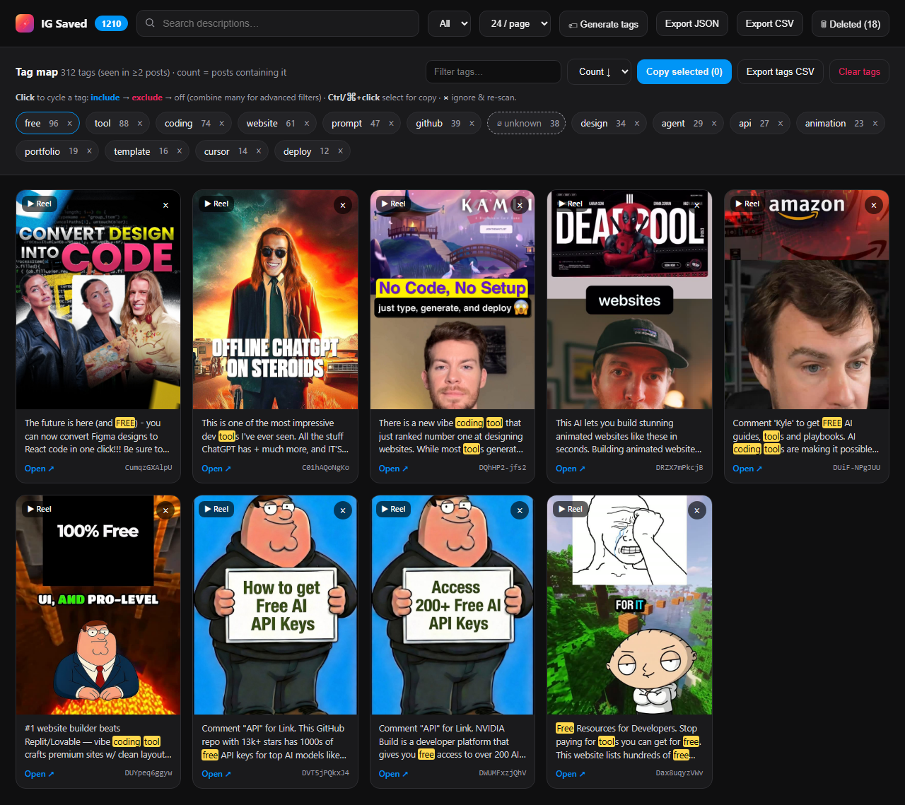
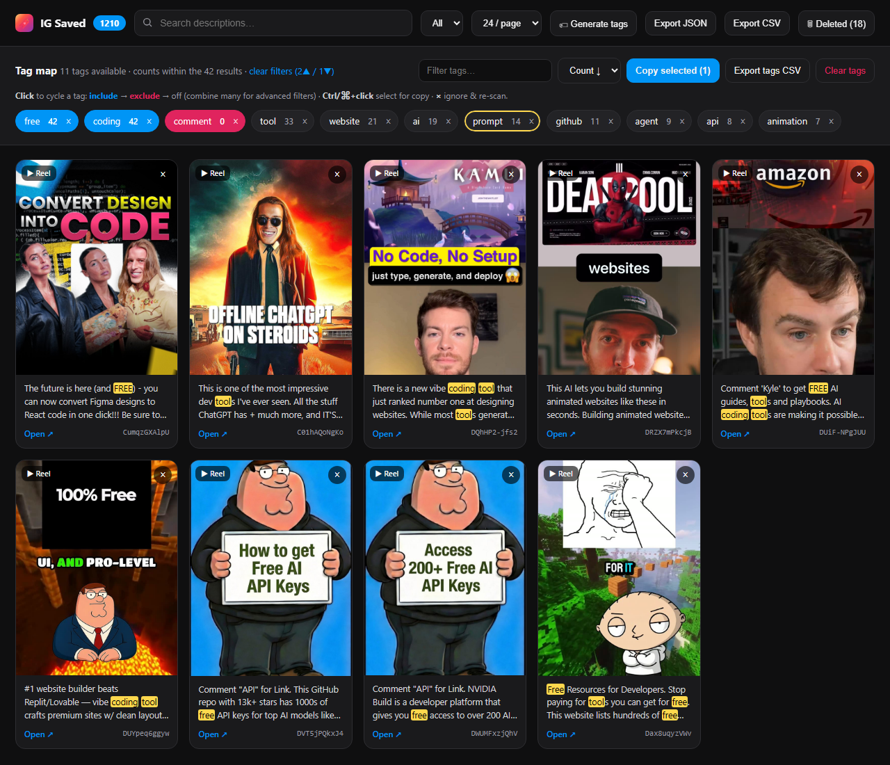
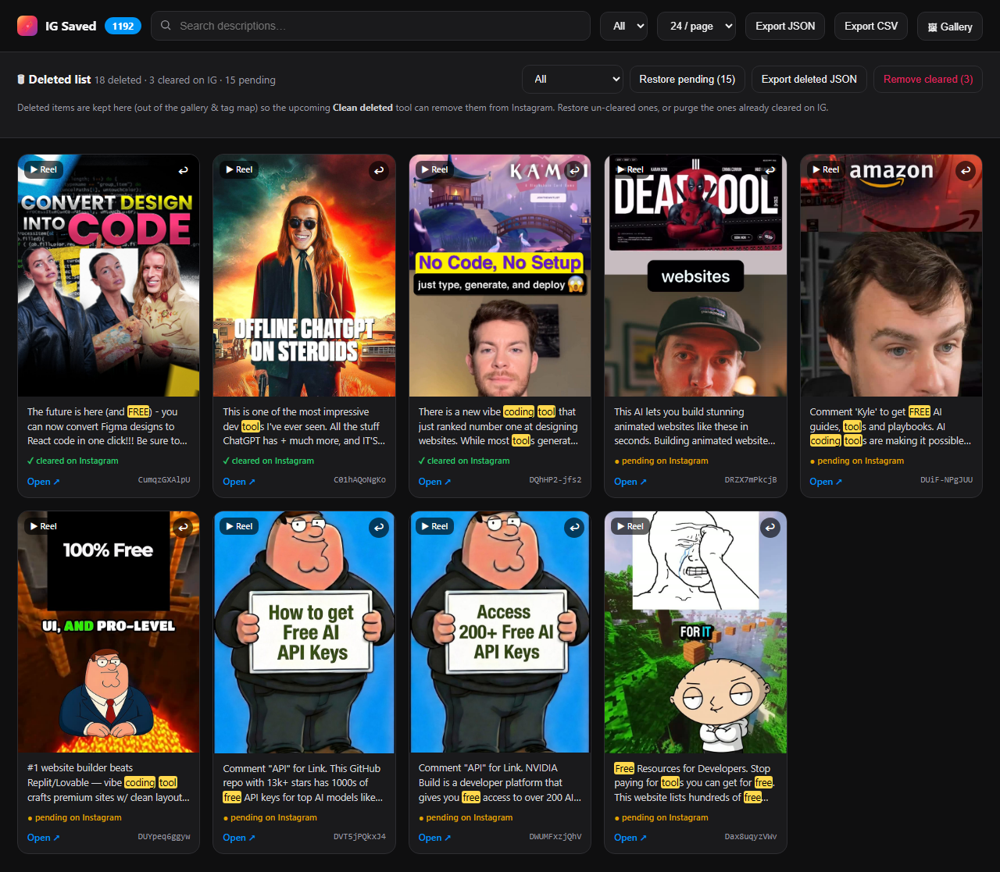

<div align="center">


# IG Saved Grabber

**Take your Instagram *Saved* collection off Instagram.**
Scroll once, capture every post, then search, tag-analyze and bulk-manage the whole thing — locally, in your browser.

[](LICENSE)


</div>

<div align="center">
  
</div>

---

Instagram lets you *save* thousands of posts and then gives you exactly **zero** tools to do anything with them — no search, no export, no bulk actions, no idea what's even in there. This extension fixes that.

It captures each saved post's **URL, thumbnail, description and type (reel/post)** as you scroll, stores everything **locally** (nothing ever leaves your machine), and opens a full-page **manager** where you can search, build a **tag map** of what you actually save, and queue posts for cleanup.

## ✨ Features

- **🖱️ One-scroll capture** — a floating panel on your saved page auto-scrolls to the bottom, grabbing every post. De-duplicated by shortcode, so re-runs never create copies.
- **🗂️ Full-tab manager** — a searchable, paginated gallery of everything you saved, with thumbnails, descriptions and links back to each post.
- **🔎 Instant search** — filter by description text with live highlighting; hover any card to read the full caption in a floating popover.
- **🏷️ Tag map** — scans every description, strips stop-words (English **and** Spanish), merges singular/plural (`app`/`apps`), and shows you a ranked map of the words you save most. Hashtags included.
- **🔵🔴 Advanced tag filters** — click a tag to **include** it (blue), click again to **exclude** it (red), click again to clear. Combine as many as you want for `A AND B AND NOT C` queries. Remaining tags **re-count live** against the current results and hide themselves when they hit zero.
- **🗑️ Deleted list & safe cleanup** — removing a post doesn't destroy it; it moves to an isolated list, ready for the upcoming *Clean deleted* tool to un-save it from Instagram. Restore or purge anytime.
- **📤 Export anything** — the gallery, a filtered subset, the tag map, or the deleted list — as **JSON** or **CSV** (Excel-safe UTF-8).
- **🔒 Zero backend** — no account, no API keys, no network calls. Everything lives in `chrome.storage.local`.

## 📸 Screenshots

<table>
<tr>
<td width="50%" valign="top">

<p align="center"><b>Advanced tag filtering</b><br/>Include (blue) + exclude (red) + copy-select (gold). Counts update to the filtered results.</p>
</td>
<td width="50%" valign="top">

<p align="center"><b>Deleted list</b><br/>Isolated from the gallery, each item tracked as pending or cleared on Instagram.</p>
</td>
</tr>
</table>

## 🚀 Install

This is an unpacked extension — no store needed.

1. **Download** this repo (green **Code → Download ZIP**, or `git clone`).
2. Open **`chrome://extensions`** in Chrome (or any Chromium browser: Edge, Brave, Arc…).
3. Toggle **Developer mode** (top-right).
4. Click **Load unpacked** and select the **`extension/`** folder.
5. Pin the 🔖 icon to your toolbar.

## 📖 Usage

### 1 · Capture your saved posts
Go to your saved page — `instagram.com/<you>/saved/all-posts/` — and a dark panel appears top-right.

- **▶ Auto-scroll to bottom** scrolls and captures until it reaches the end.
- The badge shows how many unique posts are stored; it survives reloads.
- **🗂 Open manager** jumps to the manager tab (also on the toolbar icon).

### 2 · Explore in the manager
Search descriptions, page through the grid, filter by reels/posts, and hover a card to read its full caption.

### 3 · Build & filter with tags
Hit **🏷 Generate tags** to scan every description. Then:

| Action | Result |
| --- | --- |
| **Click** a tag | Include it — results must contain it (turns blue) |
| **Click** again | Exclude it — results must *not* contain it (turns red) |
| **Click** again | Off |
| **Ctrl/⌘ + click** | Select the tag to copy (gold ring) — great for curating your stop-word list |
| **×** on a tag | Ignore that word and re-scan |

Stack multiple include/exclude tags for precise, progressive filtering.

### 4 · Curate & clean up
Remove posts you're done with (**×** on a card) — they move to the **Deleted** list instead of vanishing. From there, restore the ones you kept by mistake, or keep them queued for Instagram cleanup.

## 🧾 What gets captured

Each item is a small JSON record:

```json
{
  "shortcode": "DcUNlNvy6J9",
  "url": "https://www.instagram.com/reel/DcUNlNvy6J9/",
  "type": "reel",
  "is_reel": true,
  "image": "https://scontent.cdninstagram.com/…/cover.jpg",
  "alt": "ManyChat just made Open Reply completely FREE …",
  "captured_at": "2026-08-23T06:53:00.000Z"
}
```

> **Note on thumbnails:** Instagram's image URLs are signed and expire after a while. Freshly captured thumbnails render fine; older ones may 404 and show an *"image expired — open post ↗"* placeholder — the link always still works.

## 🔒 Privacy

Everything runs on your device. The extension has **no backend, no analytics, and makes no network requests** — it only reads the DOM of your own saved page and writes to `chrome.storage.local`. Your data never leaves your browser unless *you* click Export. Permissions are limited to `storage` and `instagram.com`.

## 🗺️ Roadmap

- [x] Scroll-capture with de-dup + export (JSON/CSV)
- [x] Full-tab manager with search & pagination
- [x] Tag map with stop-words, plural-merging & hashtags
- [x] Multi-tag include/exclude filtering with live counts
- [x] Isolated deleted list with clean-status tracking
- [ ] **Clean deleted** — auto-remove queued posts from Instagram (auto-scroll → find → un-save → mark cleared)

## 🛠️ Tech

Plain **Manifest V3** + vanilla JavaScript. No build step, no framework, no dependencies.

```
extension/
├── manifest.json     # MV3 manifest (storage + instagram.com)
├── content.js        # the on-page capture panel
├── background.js     # opens the manager tab
├── manager.html      # manager + tag map + deleted views
├── manager.js        # all manager logic
└── icons/            # generated app icons
```

## 🤝 Contributing

Issues and PRs welcome. It's a single small extension — clone it, load unpacked, hack away.

## 📄 License

[MIT](LICENSE) — do whatever you want.

---

<div align="center">
<sub>Not affiliated with, endorsed by, or connected to Instagram or Meta. For personal use with your own account.</sub>
</div>
